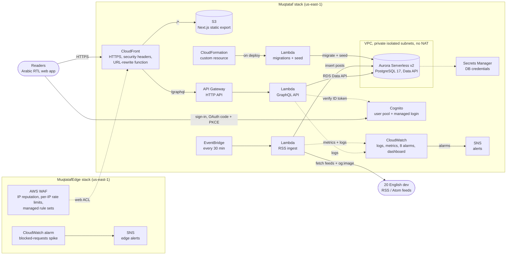

# مقتطف (Muqtataf)

An Arabic-first, right-to-left developer news aggregator in the spirit of daily.dev. It pulls English
developer articles from RSS feeds and presents them in an Arabic interface with upvotes, bookmarks,
comments, search and a personal feed. Everything runs serverless on AWS, currently in `us-east-1`. To move closer to Gulf users, see **Region** below.

> Original code, no daily.dev code or branding. The product name lives in
> `packages/web/src/lib/brand.ts`.

## Architecture

The AWS-icon version of this diagram is in [`docs/architecture.drawio`](docs/architecture.drawio). Open it at [app.diagrams.net](https://app.diagrams.net) with File → Open from → Device.



- **No NAT gateway.** The Lambdas reach Aurora through the RDS Data API, so they run outside the VPC.
- **Aurora scales to 0 ACU** when idle (`dbMinAcu: 0`). The first request after a pause takes about 15 seconds while the database wakes, and the API retries automatically. Set `dbMinAcu` to `0.5` to keep it warm.
- **Same-origin API.** CloudFront serves `/graphql`, so there is no CORS and the site needs no API URL at build time. The runtime `config.json` is written at deploy time.

| Package | What it is |
|---|---|
| `packages/db` | Drizzle schema, migrations (`drizzle/`), seed sources, PGlite and Data API clients |
| `packages/ingest` | RSS/Atom fetching, normalization, og:image enrichment, ingest Lambda |
| `packages/api` | GraphQL schema and resolvers, Lambda handler, migration handler, local dev server |
| `packages/web` | Next.js 15 static site: RTL layout, IBM Plex Sans Arabic, TanStack Query, Cognito login |
| `docs` | `architecture.drawio`: AWS-icon architecture diagram |
| `packages/infra` | AWS CDK app: stacks `Muqtataf` (everything) and `MuqtatafEdge` (WAF) |

## Local development

No Docker or AWS needed. The API uses an embedded Postgres (PGlite) stored in `.data/`, and ingests the real feeds on startup.

```bash
npm install
npm run dev:api     # http://localhost:4000/graphql (GraphiQL), ingests feeds on start
npm run dev:web     # http://localhost:3000
```

Locally, "تسجيل الدخول" (sign in) asks for any name. That is a dev-only stand-in for Cognito, sent as the `x-dev-user` header, and only the local dev server accepts it.

```bash
npm test                # unit + integration tests (PGlite)
npm run test:coverage
npm run typecheck
npm run db:generate     # after editing packages/db/src/schema.ts
npm run check-feeds -w @muqtataf/ingest   # verify every seed feed parses
```

## Deploying to AWS

1. Configure credentials for the target account, for example `aws configure sso` or `aws configure`, and verify them:
   ```bash
   aws sts get-caller-identity
   ```
2. Confirm Aurora Serverless v2 is offered for the engine version in your region (a result greater than 0 means yes):
   ```bash
   aws rds describe-orderable-db-instance-options --engine aurora-postgresql --engine-version 17.5 \
     --db-instance-class db.serverless --region us-east-1 --query 'length(OrderableDBInstanceOptions)'
   ```
3. Bootstrap CDK once per account. `us-east-1` is needed because CloudFront's WAF must be created there:
   ```bash
   npx cdk bootstrap aws://<ACCOUNT_ID>/us-east-1
   ```
4. Pick a globally unique Cognito domain prefix in `packages/infra/cdk.json` (`authDomainPrefix`), then deploy:
   ```bash
   npm run deploy
   ```
   Add `-- -c alertEmail=you@example.com` to get alarm emails, and confirm the subscription email AWS sends.
   This builds the web app and deploys both stacks: `MuqtatafEdge` (WAF, in us-east-1) first, then `Muqtataf`. The output `SiteUrl` is the CloudFront URL.
5. Fill the feed immediately, instead of waiting for the first scheduled run:
   ```bash
   aws lambda invoke --region us-east-1 --function-name <IngestFunctionName output> /dev/stdout
   ```

### Region

The main stack is deployed to `us-east-1` because `me-central-1` (UAE) is an opt-in region and is disabled on the account. To move closer to Gulf users:
1. Enable the region with `aws account enable-region --region-name me-central-1`, and wait until `get-region-opt-status` reports `ENABLED`.
2. Bootstrap CDK there.
3. Deploy with `-c region=me-central-1`.

This creates a new, empty stack, so posts are re-ingested but users and comments are not copied. The WAF stack always stays in `us-east-1`, because CloudFront requires it.

### Options (`packages/infra/cdk.json` context, or `-c key=value`)

| Key | Default | Meaning |
|---|---|---|
| `region` | `us-east-1` | AWS region for the main stack |
| `authDomainPrefix` | `muqtataf-news` | Cognito managed-login domain prefix (must be unique) |
| `dbMinAcu` / `dbMaxAcu` | `0` / `2` | Aurora Serverless v2 capacity range |
| `ingestEveryMinutes` | `30` | Feed polling interval |
| `allowLocalhostAuth` | `false` | Also allow `http://localhost:3000` as a Cognito redirect |
| `alertEmail` | unset | Email for alarm notifications (SNS) |
| `waf` | `true` | Create the WAF web ACL in front of CloudFront |
| `wafRateLimitPerIp` | `2000` | Max requests per IP per 5 min, site-wide (blocked with 429) |
| `wafGraphqlRateLimitPerIp` | `600` | Max `/graphql` requests per IP per 5 min |
| `wafBlockedAlarm` | `1000` | Blocked requests per 5 min that trigger an alert |
| `googleClientId` + `googleSecretName` | unset | Enable "Sign in with Google". The secret holds the OAuth client secret in Secrets Manager. |

### Rough monthly cost at low traffic

Aurora storage and I/O are a few dollars a month, and compute is near $0 while paused. CloudFront, Lambda, API Gateway and Cognito stay within or near their free tiers. WAF is about $10 a month: $5 for the web ACL, $1 per rule or rule group, and $0.60 per million requests. The 9 alarms cost about $1 a month, and the dashboard is free up to 3 dashboards. Running Aurora at a constant 0.5 ACU adds roughly $45–50 a month.

## Protection and monitoring

- **WAF** (stack `MuqtatafEdge`, us-east-1) is attached to CloudFront. Rules run in this order:
  1. AWS IP reputation list.
  2. Per-IP rate limits for `/graphql` and for the whole site.
  3. Known-bad-inputs rules.
  4. AWS common rule set. Its body XSS/RFI/size rules only count matches, because developers paste code in comments.
- **Alarms** go to the alerts SNS topic (one topic per stack):

  | Alarm | Fires when |
  |---|---|
  | `ApiErrors` | GraphQL Lambda errors ≥ 5 in 5 min |
  | `ApiThrottles` | Any GraphQL Lambda throttling |
  | `Api5xx` | API Gateway 5xx ≥ 10 in 5 min |
  | `ApiSlow` | GraphQL p95 ≥ 5 s for 15 min |
  | `IngestCrashed` | Ingest Lambda fails outright twice in an hour |
  | `FeedsFailing` | 5+ feeds failing in two consecutive hours |
  | `NoNewPosts` | Nothing ingested in 6 h, including when ingest stops reporting |
  | `DbAtMaxCapacity` | Aurora pinned at `dbMaxAcu` for 15 min |
  | `BlockedRequestsSpike` | WAF blocks ≥ `wafBlockedAlarm` requests in 5 min |

  `NoNewPosts` can fire once right after the first deploy, until the first ingest run. Invoke the ingest function manually to clear it.
- **Dashboard:** CloudWatch → Dashboards → `Muqtataf` (link in the `DashboardUrl` stack output). It shows API traffic and latency, Lambda errors, posts ingested, failed feeds, Aurora ACUs, WAF traffic and alarm status.
- The ingest Lambda publishes `PostsInserted`, `FeedsFailed` and `FeedsChecked` to the `Muqtataf` CloudWatch namespace on every run.

## Adding sources

Edit `SEED_SOURCES` in `packages/db/src/seed.ts`. The migration Lambda upserts this list on the next deploy. You can also insert rows into the `sources` table directly. Set `enabled = false` to pause a source.
